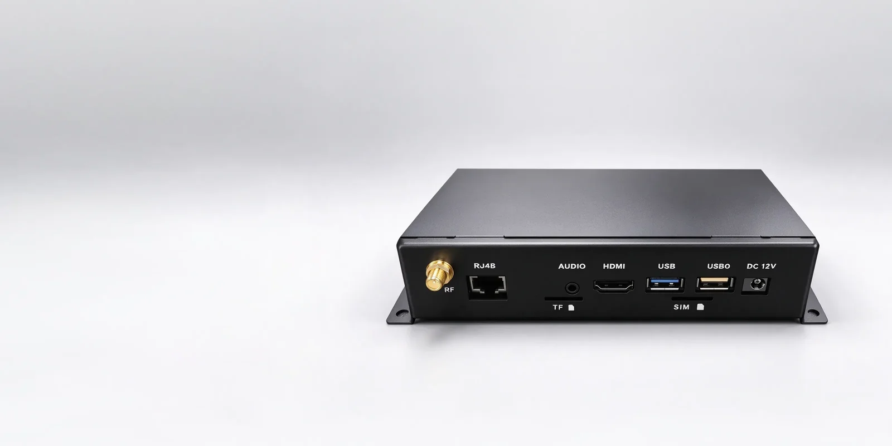
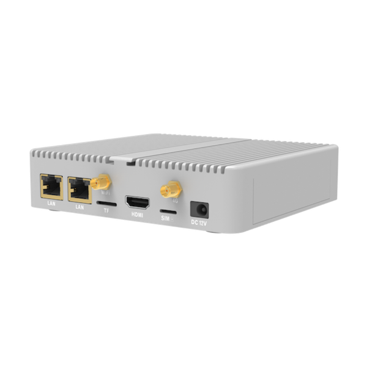
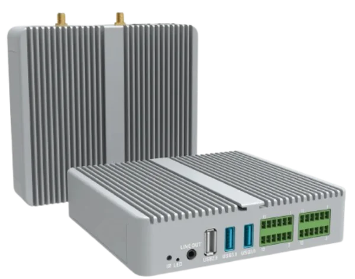
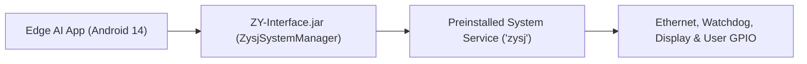

<div align="center">
  <a href="https://www.suntekai.com">
    <picture>
      <source media="(prefers-color-scheme: dark)" srcset="https://raw.githubusercontent.com/SUNTEK-Official/.github/main/profile/assets/logo-dark.png">
      <source media="(prefers-color-scheme: light)" srcset="https://raw.githubusercontent.com/SUNTEK-Official/.github/main/profile/assets/logo-light.png">
      
    </picture>
  </a>

  <h1>SUNTEK AI-Box Android 14 System & GPIO SDK</h1>

  <p>
    <strong>Official Hardware SDK &amp; Developer Kit</strong> &middot; <em>Enjoy Smarter Service</em><br>
    Official Android 14 display, Ethernet, watchdog, wireless ADB, and user GPIO system SDK (<code>sdk/ZY-Interface.jar</code> / <code>ZysjSystemManager</code>) for <strong>SUNTEK AI-Box</strong> edge compute terminals (<strong>SUNTEK Technology Co., Ltd.</strong>).
  </p>

  <p>
    <a href="./LICENSE"></a>
    <a href="https://github.com/SUNTEK-Official/suntek-sdk-aibox/releases"></a>
    
    <a href="https://www.suntekai.com/products/edge-ai-box-sa7/"></a>
    <a href="mailto:support@suntekai.com"></a>
  </p>

  <p>
    <a href="#hardware-showcase--compatibility">Hardware</a> &nbsp;&bull;&nbsp;
    <a href="#architecture--key-capabilities">Architecture</a> &nbsp;&bull;&nbsp;
    <a href="#supported-interfaces--physical-connections">Interfaces</a> &nbsp;&bull;&nbsp;
    <a href="#5-minute-quick-start">Quick Start</a> &nbsp;&bull;&nbsp;
    <a href="#sample-apps--prebuilt-downloads">Downloads</a> &nbsp;&bull;&nbsp;
    <a href="#troubleshooting--faq">FAQ</a> &nbsp;&bull;&nbsp;
    <a href="#documentation-changelog--support">Support</a>
  </p>
  
</div>

---

## Hardware Showcase & Compatibility

<table>
  <tr>
    <td align="center" width="50%">
      <a href="https://www.suntekai.com/products/edge-ai-box-sa7/">
        
      </a>
      <br>
      <strong>AI-Box (SA6 / SA7)</strong><br>
      <sub>Industrial Fanless Edge AI Box</sub><br>
      <a href="https://www.suntekai.com/products/edge-ai-box-sa7/">Official Product Page</a>
    </td>
    <td align="center" width="50%">
      <a href="https://www.suntekai.com/products/edge-ai-box-sa8/">
        
      </a>
      <br>
      <strong>AI-Box (SA8)</strong><br>
      <sub>Industrial Edge Compute Mini PC</sub><br>
      <a href="https://www.suntekai.com/products/edge-ai-box-sa8/">Official Product Page</a>
    </td>
  </tr>
</table>

| Product Model | Chipset / Board | OS Versions | Build Identifier | Status |
| :--- | :--- | :--- | :--- | :---: |
| **AI-Box** | ARM Edge Compute SoC | Android 14 | `AI-BOX*` | Supported |

> [!IMPORTANT]
> Verify your device **Model** and **Build Number** under Android **Settings -> About device** before integration. Customer applications use your own Google Play or enterprise release certificate.

---

## Architecture & Key Capabilities

- **Edge System Controls**: Programmatic reboot/shutdown, static Ethernet configuration, wireless ADB toggling, and status bar lockdown.
- **Industrial Hardware Watchdog**: Keeps mission-critical edge inference and signage nodes self-healing 24/7.
- **Complete Working SDK & Sample**: Bundles real `sdk/ZY-Interface.jar` (`android.app.ZysjSystemManager`) and complete `ZYSJ_API14` Android Studio project in `sample-android/`.



---

## Supported Interfaces & Physical Connections

| Hardware Feature | Interface Type | Device Path / Service Target | Notes |
| :--- | :--- | :--- | :--- |
| **AI-Box System SDK JAR** | Java API (`android.app.ZysjSystemManager`) | `sdk/ZY-Interface.jar` | Display, static Ethernet, watchdog, wireless ADB & user GPIO |
| **Watchdog & Wireless ADB** | System Service Calls | `context.getSystemService("zysj")` | Unattended edge runtime watchdog |
| **User GPIO / Status Bar** | Hardware Control API | `GPIO / Navigation Bar` | Kiosk mode lockdown & GPIO triggers |

---

## Repository Directory Layout

```text
suntek-sdk-aibox/
├── assets/                 # Hero banner & SA7/SA8 product photos
├── sdk/
│   └── ZY-Interface.jar    # Production AI-Box Android 14 interface library
├── docs/
│   └── aibox-android14-api-guide.md
├── sample-android/         # Complete Android Studio ZYSJ_API14 project
├── README.md
├── LICENSE
├── THIRD_PARTY_NOTICES.md
└── CHANGELOG.md
```

> All installers (`.exe`), compiled sample APKs (`.apk`), and large binary packages (> 5 MB) are hosted on [**GitHub Releases**](https://github.com/SUNTEK-Official/suntek-sdk-aibox/releases) with `SHA256SUMS.txt`.

---

## Prerequisites & Permissions

- **Platform Target**: `minSdk 24` / `targetSdk 34`
- **App Signing Requirement**: Customer applications use your own release key. System calls bind to preinstalled `zysj` system service or companion `SuntekBridgeService.apk`.
- **Required Permissions / Capabilities**: `INTERNET`, `ACCESS_NETWORK_STATE`, `RECEIVE_BOOT_COMPLETED`.

---

## 5-Minute Quick Start

### Step 1: Add `ZY-Interface.jar` Dependency

```gradle
dependencies {
    implementation fileTree(includes: ['*.jar'], dir: 'libs')
}
```

### Step 2: Acquire `ZysjSystemManager` & Configure Watchdog

```java
import android.app.ZysjSystemManager;

ZysjSystemManager manager = (ZysjSystemManager) getSystemService("zysj");
int gpioVal = manager.get_zysj_gpio_value(1);
manager.set_zysj_gpio_value(1, 1);
```

### Build & Run Sample Project

```bash
cd sample-android && ./gradlew assembleDebug
```

---

## Sample Apps & Prebuilt Downloads

Verified prebuilt APKs, offline SDK bundles, and checksum manifests are published on [**GitHub Releases**](https://github.com/SUNTEK-Official/suntek-sdk-aibox/releases). Verify downloaded archives before production deployment:

```bash
shasum -a 256 -c SHA256SUMS.txt
```

---

## Troubleshooting & FAQ

<details>
<summary><b>Where is `ZY-Interface.jar` located?</b></summary>
<p>Included directly in both `sdk/ZY-Interface.jar` and `sample-android/app/libs/ZY-Interface.jar`.</p>
</details>

<details>
<summary><b>Which Android version does AI-Box target?</b></summary>
<p>Android 14 (`compileSdk 34`, `targetSdk 34`).</p>
</details>

<details>
<summary><b>Looking for an offline NPU LLM voice assistant demo?</b></summary>
<p>See our companion repository [`suntek-demo-edge-llm`](https://github.com/SUNTEK-Official/suntek-demo-edge-llm) for Rockchip RKLLM inference and Vosk speech recognition.</p>
</details>

---

## Documentation, Changelog & Support

- **Changelog**: [CHANGELOG.md](./CHANGELOG.md)
- **Developer Documentation Portal**: [suntek-docs](https://github.com/SUNTEK-Official/suntek-docs)
- **Technical Support**: [support@suntekai.com](mailto:support@suntekai.com)
- **Bug Reports**: [Open an Issue](https://github.com/SUNTEK-Official/.github/issues/new/choose)
- **Security Disclosures**: See [SECURITY.md](https://github.com/SUNTEK-Official/.github/blob/main/SECURITY.md) or email [support@suntekai.com](mailto:support@suntekai.com)

---

<div align="center">
  
  <br><br>
  <strong>SUNTEK Technology Co., Ltd.</strong> &mdash; <em>Smart Commercial Terminal Hardware Manufacturer Since 2010</em><br>
  <sub>80+ Export Countries &middot; 5,000,000+ Terminals Shipped &middot; 500+ ODM Projects &middot; ISO 9001 / ISO 14001 / ISO 27001 / CE / RoHS</sub><br>
  <sub><a href="https://www.suntekai.com">www.suntekai.com</a> &middot; Copyright &copy; 2026 SUNTEK Technology Co., Ltd. All rights reserved.</sub>
</div>
